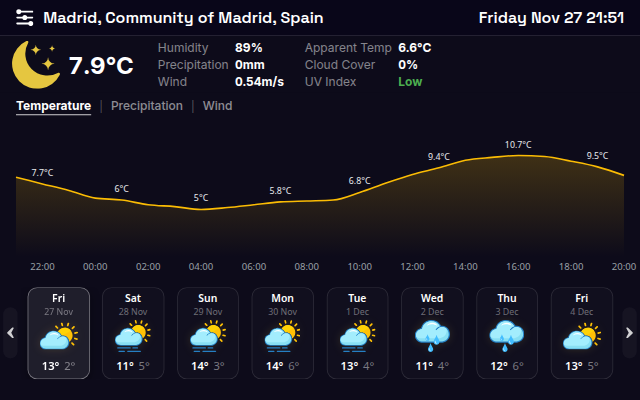
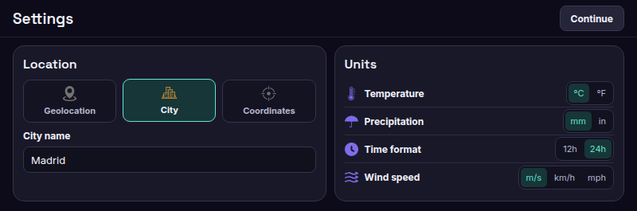

# Lord Of The Weathers

## About

Lord Of The Weathers is a non-commercial browser extension for checking local weather from the toolbar. The browser lists it as **WeatherEx**. It uses Manifest V3 and is built with React, Vite, and Recharts.

## Download Version 1.0 beta

Download the package for your browser from [GitHub Releases](https://github.com/LordMaksymus/LordOfTheWeathers/releases/tag/v1.0.0).

- **Chrome, Brave, Edge and other Chromium desktop browsers.** Unzip the Chromium package. On your browser's extensions page, enable **Developer mode**, choose **Load unpacked**, and select the extracted folder that contains `manifest.json`.
- **Firefox 140+.** Open `about:debugging#/runtime/this-firefox`, select **Load Temporary Add-on**, and choose the Firefox ZIP. Temporary add-ons are removed when Firefox exits. Permanent installation requires a [Mozilla-signed build](https://extensionworkshop.com/documentation/publish/signing-and-distribution-overview/).

## Screenshots





## Features

- Current conditions, daily forecasts, and hourly charts for temperature, precipitation probability, and wind. Select today's card to return to current conditions and the chart from the current hour.
- Search by city or enter latitude and longitude manually. Chromium and Firefox also offer browser geolocation with a preview and confirmation before saving.
- City, region, and country in the forecast header when the geocoder supplies them. Long names are shortened on screen and shown in full on hover.
- A compact settings screen with local preferences for temperature, wind speed, precipitation, and time format. Continue saves the preferences, and later launches open the forecast.
- Loading feedback, input validation, and retry controls when the forecast service fails.

## Build from source

Use Node.js 20.19+ on the 20.x line or Node.js 22.12+.

```sh
git clone https://github.com/LordMaksymus/LordOfTheWeathers.git
cd LordOfTheWeathers
npm ci
npm run build:all
```

### Chromium-based desktop browsers

Run `npm run build` to build only the Chromium version. Open the browser's extensions page, such as `chrome://extensions`, `edge://extensions`, or `brave://extensions`. Enable **Developer mode**, select **Load unpacked**, and choose `dist`. After rebuilding, reload **WeatherEx** on the extensions page.

### Firefox 140 or newer

Run `npm run build:firefox` to build only the Firefox version. Open `about:debugging#/runtime/this-firefox`, select **Load Temporary Add-on**, and choose `dist-firefox/manifest.json`. Reload the add-on there after rebuilding. Temporary add-ons are removed when Firefox exits. For permanent installation in release Firefox, use a [Mozilla-signed build](https://extensionworkshop.com/documentation/publish/signing-and-distribution-overview/).

### Safari

Run `npm run build:safari` to build the web extension resources in `dist-safari`. The Safari version offers **City** and **Coordinates**. Allow access to the forecast and geocoding services in Safari's extension settings if prompted.

On a Mac with Xcode, use Apple's packager to generate the Safari host app and Xcode project, then build and run the app in Xcode and enable the extension in Safari.

```sh
xcrun safari-web-extension-packager ./dist-safari
```

See [Apple's packaging guide](https://developer.apple.com/documentation/safariservices/packaging-a-web-extension-for-safari) for Xcode packaging and [App Store Connect packaging](https://developer.apple.com/documentation/safariservices/packaging-and-distributing-safari-web-extensions-with-app-store-connect) for the web-based option.

## Data and preferences

Preferences are stored in the browser's local extension storage. The extension sends the selected coordinates to Open-Meteo for the forecast. It sends city searches or coordinates to Nominatim to look up locations or their names. A detected position is used for forecasts only after confirmation. You can update it from Settings or use manual coordinates. See the [Privacy Policy](PRIVACY.md) for details.

Forecast data comes from [Open-Meteo](https://open-meteo.com/). Geocoding uses [Nominatim](https://nominatim.org/) and [© OpenStreetMap contributors](https://www.openstreetmap.org/copyright).

## License

Copyright © 2026 LordMaksymus. All rights reserved. See [LICENSE](LICENSE) for the terms covering the project's original material. Third-party components and data are subject to their respective licenses and terms.
